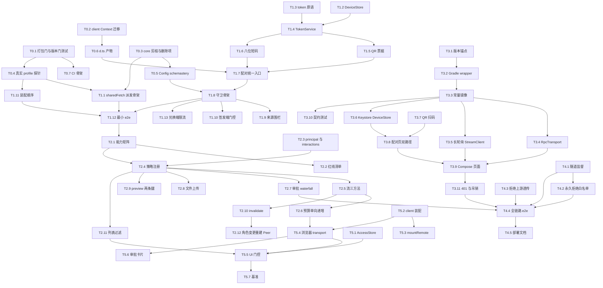

# DSH Remote Hub 实施计划

> 本文是 [DESIGN.md](./DESIGN.md) 的执行版：把设计拆成可领取、可验收、可回退的任务。
> 任务编号 `T<里程碑>.<序号>` 与源码里的 `TODO(Mx.y)`、`NOT_IMPLEMENTED` 标记互相对应，
> 对照表见 §2.8。

| 项 | 值 |
|---|---|
| 文档版本 | **v0.2** |
| 状态 | **已执行完毕**（2026-11-11：M0/M1/M2/M4/M5 的 45 个 DSH 任务全部勾选；**M3 的 11 个 Android 任务按交付需求跳过**，见 §2.5 顶部说明；验收记录见 [notes/M0-probe.md](./notes/M0-probe.md)） |
| 最后更新 | 2026-11-11 |
| 总预估 | **57.5 人日**（v0.1 为 48；差值分解见 §1.2） |
| 关键路径 | T0.1/T0.3/T0.4 → T1.2 → T1.4 → T1.7 → T1.8 → T1.9 → T1.12 → T2.1 → T2.4 → T2.5 → T2.7 → T3.3 → T3.6 → T3.8 → T3.9 → T3.11 → T4.4（见 §3） |
| 权威输入 | [04-design-deltas.md](./verification/04-design-deltas.md)（D-1…D-15） · [01-harness-facts.md](./verification/01-harness-facts.md) · [02-web-research.md](./verification/02-web-research.md) · [03-liveshare-precedent.md](./verification/03-liveshare-precedent.md) |

**v0.2 的一句话**：把 v0.1 里"自造信封 + 自造方法词表 + 自造 WebSocket + 自造 ACL"这四层自研，压成"**直接转发官方 `/api` endpoint + 官方 `registerPolicy` 裁决 + 三条自有长轮询方法 + 一个 waterfall 监听器**"，并把被源码推翻的四条假设（[01](./verification/01-harness-facts.md) F21、[04](./verification/04-design-deltas.md) D-7/D-8/D-9）在**第一天**修掉。

---

## 1. 里程碑总览

| 里程碑 | 目标 | 交付物 | 出口标准（Exit Criteria） | 预估 | 依赖 |
|---|---|---|---|---|---|
| **M0 修复与探针** | 先把"空转的兼容门、不存在的依赖、自造的协议层"清干净，再用一次真实探针确认 R-1 的剩余不确定性 | 改写后的 `package.json` 门、client 侧 `Context` 迁移、剪枝后的 `core/`、`scripts/probe-services.mjs` + `docs/notes/M0-probe.md`、CI 骨架 | 版本门四项矩阵全绿（`0.2.1-rc.2=Y / 0.2.1-rc.5=Y / 0.2.2-rc.1=Y / 0.3.0-rc.1=n`）；`pnpm typecheck && pnpm build` 全绿且依赖树里既无 `dsh-client-runtime` 也无 `ws`；探针在真实 profile 打印「Connection/Gateway 已装 + `remote-device` 有 policy + `session/list` 经 sharedFetch 返回数组」 | 6 人日 | — |
| **M1 配对与守卫** | 打通「未配对 → 配对 → 令牌 → 一次受控调用」的最小闭环，且守卫自带来源围栏 | `fence.ts` / `devices.ts` / `token.ts` / `pairing.ts` / `guard.ts` / `dispatch.ts` / `plugin.ts`、`scripts/e2e-minimal.mjs` | 签发端双条件回环门控 403、兑换端从隧道来源 200；QR 票据 32 字节 TTL 2 分钟单次、短码 8 位 40 bit 五次即烧；`Host`/`Origin`/`Sec-Fetch-Site` 三段围栏四组合全对；一次 `session/list` 经 `createSharedFetchHandler('/api').fetch(request, peer)` 往返成功 | 15 人日 | M0 |
| **M2 能力矩阵与三条自有面** | 让三档角色在官方 `decide()` 里生效（覆盖 60+ endpoint），并补齐官方不给非 owner 的三件事：流、审批、文件 | `core/src/capabilities.ts`、`host/src/{policy,streams,approval-bridge,files,principal}.ts`、`host/src/services/index.ts`（只注册 `hub/*` 自有方法）、红线断言脚本 | 只读设备调写方法得到 `remote-access/denied` 且业务方法未被进入；红线 endpoint 对 `full` 角色也全拒（自动化断言）；200 token 期间 `stream-next` 调用数随批次数线性增长（允许），但业务方法被一元轮询的次数为 0（禁止）；owner 自己的审批**不被吞掉** | 13.5 人日 | M1 |
| **M3 Android 协议层** | 手机能扫码配对、列会话、发消息、在长轮询流里看到增量、答审批 | `android/` 版本锚点替换、Keystore `DeviceStore`、`RpcTransport` + `StreamClient`、扫码页、四个 Compose 页面、契约测试 | `./gradlew :app:assembleDebug` 成功；6 条 instrumentation + 契约/transport/StreamClient/DeviceStore 单测全绿；契约快照两端逐项相等；`adb backup` 视图里看不到明文令牌 | 11.5 人日 | M2（T3.1–T3.3 可并行） |
| **M4 隧道与全链路** | 公网可达（纯 HTTP 长轮询，无 WS），两端同一设备表，吊销 ≤5s 生效 | `host/src/tunnel.ts`、`docs/DEPLOY.md`、`scripts/e2e-tunnel.mjs` | 隧道只指向 `guardPort`；`streamHoldMs`(4s) 与隧道 keepAlive 对齐后无假死；吊销后两端下一次轮询 ≤5s 得 401 | 4 人日 | M2、M3 |
| **M5 client 半边** | 浏览器侧：同源面板 + 权限快照门控 + 审批卡片（长轮询，无 WS） | `client/src/{access,transport,mount,ui}/`、`scripts/bench-poll.mjs` | 无权入口 DOM 不存在（不是 `disabled`）且 fetch 计数为 0；审批 p95 < 500ms；客户端不存在任何 WS 代码路径 | 7.5 人日 | M3、M4 |

**阶段不重叠原则**：M1 的验收不依赖 M2 的角色，M2 的验收不依赖 M3 的 Android。每个里程碑都能独立演示。

### 1.1 人日估算与依据

| 里程碑 | v0.2 | 与 v0.1 差 | 一行理由 |
|---|---|---|---|
| M0 修复与探针 | 6.0 | +1.0 | 探针从"验证能不能拿到服务"（v0.1 隐含 2.0）降到"验证装了没装 + 有没有 policy"（1.0，−1.0），但 D-7/D-8 的修复组是全新增加 2.5；`core/` 剪枝后配置面缩小，config/dts/CI 三项从 2.5 压到 2.0（−0.5） |
| M1 配对与守卫 | 15.0 | +2.0 | 删掉 `envelope.ts` 自实现与手写 `invoke()` 封装（−1.5），但 QR 为主路径（+1.5）、8 位 Crockford 短码 + 预算烧码（+0.5）、来源围栏自实现（+1.0）、`registerPolicy` 先于 `createPeer` 的装配断言（+0.5）都是新工作 |
| M2 能力矩阵与自有面 | 13.5 | +5.5 | 删掉十个业务方法的翻译层（−3.0），但 D-11 要把 60+ 官方 endpoint 分三层资源种类铺成 allow-list 且逐条归属 role（+3.5）、D-3 的流三方法与预算（+2.5）、D-5 的 waterfall 桥接（+1.5）、D-6 的文件两条腿（+1.0） |
| M3 Android 协议层 | 11.5 | +1.5 | 删掉整条 `EventSocket`（−2.0）与 Kotlin 侧的 hub 词表镜像（−1.0），但版本锚点全量更新到 AGP 9.5.1 / Kotlin 2.4.21 / BOM 2026.09.00 并打通首次构建（+1.0）、扫二维码（+1.0）、长轮询 `StreamClient`（+1.5）、契约快照重构（+1.0）是新增 |
| M4 隧道与全链路 | 4.0 | 0 | 隧道不再需要 WS 支持（CF 的 WS 空闲超时问题随 D-3 消失，−0.5），但"`streamHoldMs` 与隧道 keepAlive 对齐"需要实测校准（+0.5） |
| M5 client 半边 | 7.5 | −0.5 | 删掉 WS 心跳/重连/半开检测/退避整套（−2.5），长轮询客户端（+1.0）与审批卡片三值语义（+0.5）补回一部分后净减少 |
| **合计** | **57.5** | **+9.5** | |

### 1.2 与 v0.1 的 48 人日差值分解

| 变更项 | Δ 人日 | 依据 |
|---|---|---|
| **M0：打包兼容门（`engines.dsh` 上下界 + `manifestVersion` + `dshReleases`）+ client 半边依赖修复** | **+2.5** | D-7 / D-8 |
| M0：探针从"验证能不能拿到服务"收窄为"验证装了没装 + 有没有 policy" | −1.0 | [01 §2 第 1 条](./verification/01-harness-facts.md) |
| M0：`core/` 剪枝后 config / 类型 / CI 面缩小 | −0.5 | D-1 |
| *M0 小计* | *+1.0* | 5.0 → 6.0 |
| **M1：QR 为主路径（32 字节票据 + TTL 2 分钟 + 单次使用）** | **+1.5** | D-14 |
| **M1：8 位 Crockford Base32 短码 + 五次预算烧码** | **+0.5** | D-14、[02 §F](./verification/02-web-research.md) 的 RFC 8628 算例 |
| M1：守卫来源围栏自实现（三段，且不能引用 `isTrustedApiRequest`） | +1.0 | D-9 |
| M1：`registerPolicy` 先于 `createPeer` 的装配断言 | +0.5 | D-13 |
| M1：删除 `envelope.ts` 自实现与手写 `invoke()` 封装 | −1.5 | D-1 / D-2 |
| *M1 小计* | *+2.0* | 13.0 → 15.0 |
| **M2：角色矩阵改为官方 endpoint allow-list 并按资源种类分层（含红线清单与断言）** | **+3.5** | D-11 |
| **M2：流的三条一元方法 + 六个预算常量 + 单向 cursor** | **+2.5** | D-3 / D-4 |
| **M2：审批 waterfall 桥接的正确形状（含"不吞 owner"的反向断言）** | **+1.5** | D-5 |
| M2：文件传输两条腿（上传走 Remote 方法 / 预览 read 与 readBytes 分流） | +1.0 | D-6 |
| M2：删除十个业务方法的翻译层 | −3.0 | D-1、ADR-8 作废 |
| *M2 小计* | *+5.5* | 8.0 → 13.5 |
| **M3：Android 版本锚点全量更新（AGP 9.5.1 / Kotlin 2.4.21 / BOM 2026.09.00）与首次构建打通** | **+1.0** | D-10 |
| **M3：扫二维码（CameraX + 解码器）** | **+1.0** | D-14 |
| **M3：长轮询 `StreamClient`（替代 `EventSocket`）** | **+1.5** | D-3 |
| M3：契约快照重构（去掉词表，新增预算与能力快照） | +1.0 | D-1 |
| M3：删除整条 `EventSocket`（心跳 / 重连 / 半开 / 退避） | −2.0 | D-3 |
| M3：删除 Kotlin 侧的 hub 方法词表镜像 | −1.0 | D-1 |
| *M3 小计* | *+1.5* | 10.0 → 11.5 |
| M4：不再要求隧道支持 WS（CF 的 WS 空闲超时问题随 D-3 消失） | −0.5 | D-3、[02 §C.1](./verification/02-web-research.md) |
| M4：长轮询预算与隧道 keepAlive 的实测校准 | +0.5 | D-4 |
| *M4 小计* | *0.0* | 4.0 → 4.0 |
| M5：删除 WS 心跳 / 重连 / 半开检测 / 退避整套 | −2.0 | D-3 |
| M5：长轮询客户端（`hub/stream.next` 循环 + 超时判定） | +1.0 | D-3 / D-4 |
| M5：审批卡片三值语义（`allowed-once`/`rejected`/`cancelled`，无 `unavailable` 按钮） | +0.5 | D-5 |
| *M5 小计* | *−0.5* | 8.0 → 7.5 |
| **合计** | **+9.5** | 48 → **57.5** |

> 未计入（与 v0.1 相同）：真机适配、运维交接、npm 发布与文档翻译。

---

## 2. 任务分解

粒度约定：单条任务 0.5–2 人日。每条格式为
`- [ ] T<id> <动词开头的具体任务> — 产出：<文件/接口> — 验收：<可验证的断言>`

### 2.1 M0-A 修复任务组（必须最先做，阻塞一切，2.5 人日）

> 这一组的三件事在 v0.1 里根本不存在，或写错了。它们不是"清理"，因为**现状每一条都会让后续验收静默通过**：兼容门空转 → 任何 DSH 版本都被放行；client 依赖不存在的包 → `typecheck` 一直对着 0.1.x 的旧形状通过；自造信封 → 与官方 wire 形状永远对不上。

- [x] T0.1 改写 `package.json` 的四项兼容门 — 产出：`engines.dsh = ">=0.2.1-rc.2 <0.3.0-0"`、`engines.node = ">=24.9.0"`、`dsh.manifestVersion: 1`、`dsh.compatibility` 同步为同范围并把 `dshReleases` 补 `"0.2.2-rc.1": "compatible"` — 验收：`scripts/version-gate.mjs` 用 `semver.satisfies(range, {includePrerelease:true})` 断言矩阵 `0.2.1-rc.2=Y / 0.2.1-rc.5=Y / 0.2.2-rc.1=Y / 0.3.0-rc.1=n`；断言 `engines.node` 与 DSH 本体一致（`>=24.9.0`，不是 `ws` 的宽松下限） （0.5 人日）
- [x] T0.2 删除 `@deepseek-ai/dsh-client-runtime` 依赖并把 client 侧改用 cordis 的 `Context` — 产出：`package.json` 依赖移除、`client/src/{index,plugin,mount}.ts` 的 `import type { Context } from '@deepseek-ai/cordis'` — 验收：`pnpm typecheck` 与 `pnpm build` 全绿；`! grep -rn 'dsh-client-runtime' package.json client core host`；`grep -rn 'ClientContext' client/src` 零命中 （0.5 人日）
- [x] T0.3 剪掉 `core/` 的自造协议层并显式记录删除项 — 产出：删除 `core/src/envelope.ts`、`REMOTE_METHODS`、`REMOTE_EVENTS`、`RpcRequest`、ADR-8 翻译层、`GUARD_ROUTES.events`；`core/` 只留 `GUARD_ROUTES`、能力矩阵、设备/配对类型、错误码映射 — 验收：`core/` 的导出清单恰为这四类（快照断言）；`! grep -rq 'remote/events' core host client`；`package.json` 的 `dependencies` 中**没有** `ws`（这一条要写进 PR 描述："D-3 决定 v1 不起任何 WebSocket，`ws` 是显式删除项，不是遗漏"）；`! grep -rn "registerUpgrade\|on('upgrade'" host client` （1.5 人日）

### 2.2 M0-B 探针与基线（3.5 人日）

> 探针**仍然是第一天做的**，但它验证的问题变了：不再是"第三方能不能拿到 `createPeer`"（[01 §2 第 1 条](./verification/01-harness-facts.md) 已在源码层确认服务层无包名 allow-list），而是"**该 profile 装没装 Connection/Gateway + 我的 kind 有没有 policy**"。失败点只可能落在这两处 [01 §6](./verification/01-harness-facts.md)。

- [x] T0.4 写真实 profile 探针 — 产出：`scripts/probe-services.mjs` + `docs/notes/M0-probe.md` — 验收：在 `dsh --profile web` 下打印 `connection: ok / typertGateway: ok / claimable-endpoints: >0 / remote-device-policy: registered / session-list-ok: N`；若 Connection 或 Gateway 缺席，输出必须指名缺哪个服务（`ctx.inject(['connection','typertGateway'])` 的失败点）而不是笼统报错 （1 人日）
- [x] T0.5 把 `host/src/config.ts` 改为 schemastery `Config` 并加入新字段 — 产出：`host/src/config.ts`（`guardHost` 回环校验、`publicAuthorities: string[]`、`streamHoldMs`、`streamBatchMax`、`streamBatchWindowMs`、`streamPollSlackMs`、`hubReadTimeoutMs`、`streamIdleTtlMs`、`pairQrTtlMs`、`pairCodeTtlMs`、`maxPairAttempts`）— 验收：`guardHost: '0.0.0.0'` 在加载期抛错且错误文本含"loopback"；默认值用 `toEqual` 与常量表逐字段相等；预算常量默认值与 D-4 完全一致 （1 人日）
- [x] T0.6 开回 `.d.ts` 产物 — 产出：`tsdown.config.ts` 的 `dts: { build: true }`、`package.json` 的 `types` 路径 — 验收：`pnpm build` 产出 `lib/types/host/src/index.d.ts` 与 `lib/types/client/src/index.d.ts`，`tsc --noEmit` 零错误 （0.5 人日）
- [x] T0.7 建 CI 骨架 — 产出：CI 配置（typecheck + build + `node --test` + `scripts/version-gate.mjs` + 红线断言占位）— 验收：故意把 `engines.dsh` 改成 `>=0.2.1-rc.2` 时 CI 变红（上界缺失必须被抓住）；恢复后变绿 （0.5 人日）
- [x] T0.8 修正 README 与 DESIGN 的口径差异（本任务只记录待改点，不改他人文件）— 产出：`docs/notes/M0-probe.md` 内的「需同步 DESIGN/README 的条目」清单 — 验收：清单至少覆盖这六条（`engines.dsh` 与新版本门、删除 `ws`、删除信封与词表、流改长轮询、审批改 waterfall、配对改 QR + 8 位短码），每条给出 DESIGN/README 的待改小节号与一句替换建议 （0.5 人日）

### 2.3 M1 配对与守卫（15 人日）

- [x] T1.1 实现守卫的一元派发骨架（D-2 的核心） — 产出：`host/src/dispatch.ts` 的 `dispatch(request, peer)`，内部 `ctx.connection.createSharedFetchHandler('/api').fetch(new Request('http://remote-hub.internal/api/<ns>/<method>', init), peer)` — 验收：`{kind:'remote-device',deviceId:'d1',role:'read-only'}` 对 `session/list` 派发成功；未认领 endpoint 得 404、非 owner 打 exact Fetch 路由得 403，两者都被翻译成可诊断错误（不得变成 `internal`）；代码里**没有** `invoke(` 出现在派发路径上（`invoke()` 只允许出现在 `scripts/probe-services.mjs` 与 `hub/*` 管理方法） （1.5 人日）
- [x] T1.2 实现 `DeviceStore` — 产出：`host/src/devices.ts`（`@deepseek-ai/dsh-atomic-write` 的 `writeFileAtomic` + `withFileLock`，`mode: 0o600` / `dirMode: 0o700`）— 验收：并发 100 次 `insert` 后文件可解析且 `devices.length === 100`；`{"version":2}` 时 `createDeviceStore` 抛错（fail-closed，不得清空）；写入中途 kill 后文件仍可解析；两个进程交叉读改写不丢条目 （1.5 人日）
- [x] T1.3 实现令牌原语 — 产出：`host/src/token.ts` 的 `generateToken` / `hashToken` / `verifyTokenHash` — 验收：令牌匹配 `^[A-Za-z0-9_-]{43}$`；`hashToken` 输出 `^[0-9a-f]{64}$`；`verifyTokenHash(t+'x', hash(t)) === false` 且**不抛异常**（长度不等走同一路径） （0.5 人日）
- [x] T1.4 实现 `TokenService` — 产出：`host/src/token.ts` 的 `createTokenService` — 验收：`issue()` 后 `verify()` 返回 `{deviceId, role}`；`revoke()` 后 `verify() === null`；`onRevoked` 收到一次通知；返回的 `device.tokenHash` 不等于明文令牌 （1 人日）
- [x] T1.5 实现 QR 配对票据服务 — 产出：`host/src/pairing.ts` 的 `issueTicket(role)` / `redeemTicket(ticket, clientLabel)` — 验收：载荷为 32 字节随机（base64url，43 字符）；TTL 精确 120_000ms；同一票据 `redeem` 两次第二次返回 `pair-invalid`（redeem 即 burn）；票据本身**不含** `deviceId`/`role`（角色在兑换时由签发记录决定） （1 人日）
- [x] T1.6 实现 8 位 Crockford Base32 短码 — 产出：`host/src/pairing.ts` 的短码分支 — 验收：码长恒为 8、字符集为 Crockford 字母表（不含 `I L O U`）、熵 ≥ 40 bit（`scripts/sec-check.mjs` 断言空间下界 2^40）；TTL 600_000ms；连续 5 次错码后第 6 次返回 `rate-limited` 且**正确码也已失效**（成功或预算耗尽都必须 burn）；比较走常量时间 （1 人日）
- [x] T1.7 实现配对统一入口 — 产出：`host/src/pairing.ts` 的 `issueTicket` / `issueCode` / `redeemTicket` / `redeemCode`（两条路径共享签发端门控与角色绑定）— 验收：两条路径都经过同一个签发出口（代码结构断言）；设备记录写入后 `label` 与 `role` 来自签发方而非请求体；每次成功兑换写一条审计行（`deviceId` / `path: 'qr'|'code'` / 时间） （1.5 人日）
- [x] T1.8 实现守卫骨架 — 产出：`host/src/guard.ts` 的 `startGuard`（`node:http` 独立监听，仅回环字面量，按 `GUARD_ROUTES` 挂路由，其余一律 404）— 验收：`ss -ltnp` 只显示 `127.0.0.1:8443`；`GET /remote/health` 200；`POST /remote/rpc` 无令牌 401；`GET /api/session/list` 404；`GET /nope` 404；`dispose()` 后端口可被再次绑定 （1.5 人日）
- [x] T1.9 实现守卫自己的来源围栏（D-9，三段） — 产出：`host/src/fence.ts` 的 `checkSource(req, { publicAuthorities, protocol })` — 验收：① `Host` ∈ 允许集合（回环字面量恒允许 + `publicAuthorities` 显式声明，canonical 校验照 `assertTrustedAuthority` 的判据）② `Sec-Fetch-Site: cross-site` 一律拒 ③ 有 `Origin` 时必须与 `Host` 同 authority、`Origin: null` 拒；单测覆盖六组合（回环/公开 × 无 Origin/同源/异源/`null`/cross-site）；**不得**引用 `isTrustedApiRequest`（未从包根导出，`./src/*` 不在发布产物里）；文件头写明"同语义独立实现，升级 DSH 时需重核" （2 人日）
- [x] T1.10 实现签发端双条件回环门控 — 产出：`host/src/guard.ts` 的 `checkLoopback`（socket 数值地址回环 **且** `Host` 头回环）— 验收：单测四组合只有双回环通过；`POST /remote/pair/code` 与 `POST /remote/pair/ticket` 从隧道来源 403；`POST /remote/pair`（兑换）从隧道来源携带正确凭证得 200（v0.1 的 C1 结论保留，D-15） （1 人日）
- [x] T1.11 实现 host 装配与失败即抛 — 产出：`host/src/plugin.ts` 的 `applyRemoteHub` — 验收：装配顺序被断言（`registerPolicy` **先于**第一个 `createPeer`，任一步失败整体抛错，D-13）；端口被占时 `apply` 抛错且插件不进入就绪；`dispose()` 后端口与子进程全部释放 （1 人日）
- [x] T1.12 端到端最小链路 — 产出：`scripts/e2e-minimal.mjs` — 验收：脚本依次打印 `pair-ok / token-len 43 / list-count N / exit 0`；把令牌改一个字符后输出 `unauthorized`；`interactions` 为 `'none'` 的 Peer 尝试开 `$events` 被拒（错误 id 以 `gateway/` 开头） （1 人日）
- [x] T1.13 实现兑换端限流（与预算互相独立） — 产出：`host/src/guard.ts` 的限流中间件 — 验收：同一来源 1 分钟内第 11 次兑换得 429 `rate-limited`；换来源后计数独立；限流**不取代**短码的一次性与预算（两个机制分别有断言） （0.5 人日）

### 2.4 M2 能力矩阵与三条自有面（13.5 人日）

- [x] T2.1 把官方 endpoint 铺成三档角色 × 三种资源种类的 allow-list — 产出：`core/src/capabilities.ts`（`ROLE_ACTIONS[kind]`：`global` / `session` / `workspace` 三级）— 验收：矩阵里每个 action 都是 `<namespace>/<method>` 形式且能在 [01 §5](./verification/01-harness-facts.md) 的官方 endpoint 表里找到；三个 role 的 `resource` 用的是资源**种类**而非 id；`read-only ⊂ control ⊂ full` 逐项包含关系断言；`session/page` 不得出现（已 `@deprecated`，改用 `session/events`） （2 人日）
- [x] T2.2 把红线写成数据 + 断言 — 产出：`core/src/capabilities.ts` 的 `NEVER_DELEGATED` 集合 — 验收：`credentials/describe|set|unset`、`settings/update|replace|mutate|openSettingsDocument`、`directoryPicker/pick|list|createDirectory`、`pluginInventory/list`、`account/*`、`remoteAccess/follow`、`$events`/`$events/result` 全部在集合内（除 `account/*` 与 `pluginManager/*`/`pluginMarket/*` 外，其余都能在 [01 §5](./verification/01-harness-facts.md) 的 endpoint 表里逐条查到；完整清单与逐条理由见 DESIGN §8.6.5，本节以它为准）；`pluginManager/*` 与 `pluginMarket/*` 同属红线，**namespace 已核实为 camelCase**（`super(ctx,'pluginManager')`、`super(ctx,'pluginMarket')`），但其**方法名清单**须在开工时用 `ctx.typert.local.list()` 枚举核对后写入（01 §5 未覆盖这两个 namespace，属待核对项，不得凭记忆填）；`scripts/redlines.mjs` 以 `full` 角色逐个调用，全部得到 `remote-access/denied`（其中 `remoteAccess/follow` 是官方恒放行的例外，**必须由我们自己的 `bindings()` 再判一次**，断言"未注册则 deny"）；断言 allow-list 与红线集合交集为空 （1 人日）
- [x] T2.3 声明 `remote-device` principal 并造 Peer — 产出：`core/src/device.ts` 的 `declare module` 合并 + `host/src/principal.ts` 的 `remoteDevicePrincipal(device)` + `host/src/dispatch.ts` 的 `createDevicePeer(device)` — 验收：principal 深层等于 `{kind:'remote-device', deviceId, role}`，**不含** `tokenHash`/`label`/时间戳（D-12）；`createPeer` 显式传 `interactions: 'none'`（D-13）；把该 principal 写进 Session 日志后，日志里搜不到 43 字符 base64url 令牌 （1 人日）
- [x] T2.4 实现策略注册与 `bindings()` / `explain()` — 产出：`host/src/policy.ts` 的 `registerDevicePolicy` — 验收：只读设备的 `bindings()` 不含任何写动作；`explain()` 对写请求返回 `'no-allow'`；`bindings()` 内无 `await`、无 I/O（静态检查）；同一 kind 重复注册抛错（D-13 的前提） （1.5 人日）
- [x] T2.5 实现流的三条一元方法（D-3） — 产出：`host/src/streams.ts` 的三方法主体 + `host/src/services/index.ts` 的 `hub/stream.{open,next,cancel}` 注册（三者都走 `POST /remote/rpc`，`method` 分别为 `hub/stream.open/next/cancel`——**不新开守卫路由**，否则绕开 `decide()`；见 DESIGN §8.5；注册在 `TypertRemoteService` 上，因此同样过 `decide()`）；下行由 `ctx.typertGateway.wireStream.open(endpoint, payload, emptyViewerUplink, peer, signal)` 拉取后分发 — 验收：`open` 返回 `{streamId, cursor}`；`next` 在 `streamHoldMs`(4000) 内无帧时返回空批而不是挂死（服务端 `hubReadTimeoutMs` 25000 兜底）；`cancel` 后 `next` 返回终态 `stream-cancelled`；未知 `streamId` 返回 `stream-not-found`；三条方法都受角色矩阵管辖（只读设备可 `open`/`next`，写动作仍走 `decide()`） （1.5 人日）
- [x] T2.6 实现持有/批量预算与单向递增（D-4） — 产出：`host/src/streams.ts` 的预算层 — 验收：单批 ≤ `streamBatchMax`(64)、批次窗口 `streamBatchWindowMs`(4)；`cursor` 严格单调，旧 cursor 被拒（`hub/cursor-invalid`）；预算常量只允许单向递增（同 cursor 重复拉取不产生新帧，断言第二次调用返回空批） （1 人日）
- [x] T2.7 实现审批 waterfall 桥接（D-5） — 产出：`host/src/approval-bridge.ts` 的 root-scope `ctx.on('approval/request', async (req, next) => …)` — 验收：**不接管就 `next()`**——接管条件是"该 agent 的 session 在本设备可见集合内"这一显式判定，代码里不存在"总是接管"的分支；远端决定只返回 `allowed-once | rejected | cancelled` 三值；`unavailable` 只能由超时/吊销产生（断言：桥接主动返回 `unavailable` 的代码路径不存在）；**不得**调用 `approval.request()`（会要求 turn 已打开并把审计写两遍）；不接管时 owner 的审批照常到达本机 UI（见 §4.3 的反向断言）；每次远端应答写一条审计（`deviceId`/`callId`/`outcome`/时间） （2 人日）
- [x] T2.8 实现文件上传（D-6） — 产出：`host/src/files.ts` 的上传分支 — 验收：走 `fileUploads/upload`（Remote 方法）成功；**不走** `POST /api/session/uploadFileBinary`（断言该路由在守卫侧恒 404，且在 README/代码注释里写明"非 owner 恒 403，所以不可用"）；上传结果的附件投影（`ConnectionRpcHandlerResult` 的 `attachments`）经 sharedFetch 正确回到客户端 （1 人日）
- [x] T2.9 实现 `results.preview` 两条腿（D-6） — 产出：`host/src/files.ts` 的预览分支 — 验收：文本走 `workspaceFiles/read`（带 `offset`/`limit`，返回 `lines`/`eof` 行窗口）；含 NUL 的二进制或图片走 `workspaceFiles/readBytes`（带 `range`，`maxFileBytes` 默认 32 MiB）；对二进制文件调用 `read` 时期望得到 `workspace-file/not-text`，且守卫把它翻译成"请走二进制通道"而不是 `internal` （1 人日）
- [x] T2.10 接上 `invalidate()` 与快照重算 — 产出：`host/src/policy.ts` 的 `invalidate(deviceId?)` — 验收：角色从 `read-only` 改为 `control` 后 ≤1s，该设备已开的 `remoteAccess/follow` 流收到含新动作的 `upsert` 帧 （0.5 人日）
- [x] T2.11 列表方法逐项过滤 — 产出：`host/src/policy.ts` 的 `filterVisible()` + `session/list`/`session/search` 的包装 — 验收：构造 3 个会话、只授予其中 1 个读权限，`session/list` 返回恰好 1 条；日志中不对另外 2 个读字段（`session/search` 已按 `allows()` 过滤，此处只需断言不扩大） （0.5 人日）
- [x] T2.12 角色变更 / 吊销时重建 Peer — 产出：`host/src/dispatch.ts` 的 Peer 生命周期表 — 验收：改角色后设备的下一次请求携带新角色（审计行断言），旧 Peer 的 `signal.aborted === true`；吊销后 ≤5s 内该设备下一次 `hub/stream.next` 得到终态错误 `device-revoked` （0.5 人日）

### 2.5 M3 Android 协议层（11.5 人日）

> **⚠️ 本里程碑整体跳过（2026-11-11，按交付需求）**：「执行计划，安卓部分不需要实现，
> 完成全部 dsh 插件部分」。以下 11 个任务保留原文以便将来重启时直接领取；
> 已完成的配套工作是：删除 `android/**/EventSocket.kt`（v0.1 遗留 WebSocket，
> 满足 G-1 仓库级断言）、把 `RpcTransport.kt` 注释改为占位说明（v1 无任何 socket 升级）、
> 并由 `scripts/contract-check.mjs` 导出 `out/contract.json` 六键契约供未来 Kotlin 镜像消费。

- [ ] **[跳过·M3 按需求不实现]** T3.1 替换版本锚点并删掉 `security-crypto` — 产出：`android/build.gradle.kts`（Kotlin 2.4.21 / AGP 9.5.1）、`android/app/build.gradle.kts`（Compose BOM 2026.09.00 / `kotlinx-serialization-json` 1.12.0 / OkHttp 5.5.1；移除 `androidx.security:security-crypto`）— 验收：`! grep -q 'security-crypto' android/app/build.gradle.kts`；版本号逐项等于 [02 §D.2](./verification/02-web-research.md) 的锚点；`compileSdk` 的最低要求由本次构建实测确定并写进 `android/README.md`（脚手架现值 35，**不预判**） （1 人日）
- [ ] **[跳过·M3 按需求不实现]** T3.2 补 Gradle wrapper 并跑通首次构建 — 产出：`android/gradle/wrapper/*`、`android/gradlew*` — 验收：`./gradlew :app:assembleDebug` 产出 APK；CI 缓存命中后 < 5 分钟 （0.5 人日）
- [ ] **[跳过·M3 按需求不实现]** T3.3 建 Kotlin 常量镜像（**不含**方法词表） — 产出：`protocol/{GuardRoutes.kt, Capabilities.kt, ErrorCodes.kt, StreamBudget.kt}` — 验收：`StreamBudget.HOLD_MS == 4000` 等六个常量（含 `streamIdleTtlMs`）与 TS 侧逐项相等（契约测试）；`GuardRoutes` 恰为五条：`health` / `pairTicket` / `pairCode` / `pair` / `rpc`（与 DESIGN §7.2.4 的路由表逐条相等；流**不占路由**，走 `rpc` + `method=hub/stream.*`）；错误码集合等于 `ERROR_CODES` （1 人日）
- [ ] **[跳过·M3 按需求不实现]** T3.4 实现 `OkHttpRpcTransport` — 产出：`net/RpcTransport.kt` — 验收：请求打到 `/api/<ns>/<method>` 且带 `Authorization: Bearer`；URL 里没有 `token`；MockWebServer 覆盖「200 / 401 → Unauthorized / 403 `remote-access/denied` → 分类为"入口不该存在"而非网络错误 / 500 / 超大响应」 （1 人日）
- [ ] **[跳过·M3 按需求不实现]** T3.5 实现长轮询 `StreamClient`（替代 `EventSocket`） — 产出：`net/StreamClient.kt`（`open` → 循环 `next` → `cancel`；`cursor` 只增不减）— 验收：MockWebServer 分两次返回 1,2 与 3，客户端回调序列为 1,2,3；`408/429/502/503/504` 与 `stream-not-found` 视为可重试，其它 4xx 视为终态；`device-revoked` 触发清令牌并停止循环（连接计数不再增长）；`EventSocket.kt` 已删除（`! test -f android/app/src/main/kotlin/dev/dsh/remote/net/EventSocket.kt`） （1.5 人日）
- [ ] **[跳过·M3 按需求不实现]** T3.6 实现 Keystore 包裹 AES-256-GCM 的 `DeviceStore`（D-10） — 产出：`security/DeviceStore.kt` — 验收：`KeyGenParameterSpec` + `PURPOSE_ENCRYPT|DECRYPT` + `BLOCK_MODE_GCM` + 不可导出密钥，密文+IV 存普通 `SharedPreferences`；`saveToken` 后 `token()` 返回原值、`clear()` 后返回 null；`adb backup` 视图里看不到明文；解密失败返回 null 而非崩溃；`allowBackup="false"` 保持 （1 人日）
- [ ] **[跳过·M3 按需求不实现]** T3.7 实现扫二维码（独立任务） — 产出：`pairing/QrScanScreen.kt` + `pairing/QrDecoder.kt` — 验收：CameraX 预览 + 解码器（ML Kit barcode 或 ZXing，二选一见 §8 Q12）；对静态图片样例（打包进 test resources）解码成功；权限被拒时回退到短码输入页而不是死循环；解码器不联网 （1.5 人日）
- [ ] **[跳过·M3 按需求不实现]** T3.8 实现配对页双路径与短码兜底 — 产出：`ui/PairingScreen.kt` — 验收：扫码成功即兑换并进列表；短码路径：正确码 → 进列表，错误 5 次 → 显示"请让主机重新出码"且不再发请求（MockWebServer 断言请求数停在 5） （1 人日）
- [ ] **[跳过·M3 按需求不实现]** T3.9 四个 Compose 页面 — 产出：`ui/{SessionList,SessionDetail,ApprovalSheet}.kt` + 导航 — 验收：instrumentation 覆盖「配对成功进列表 / 列表点进详情 / `control` 可发送 / 审批卡片显示**完整原始参数**」；`read-only` 下 `onNodeWithTag("composer").assertDoesNotExist()` （1.5 人日）
- [ ] **[跳过·M3 按需求不实现]** T3.10 跨端契约测试 — 产出：`scripts/export-contract.mjs` + `app/src/test/.../ContractTest.kt` — 验收：`out/contract.json` 内容为 `{guardRoutes, protocolVersion, errorCodes, capabilities, streamBudget, officialEnvelopeSnapshot}`；两端逐项相等；**不含**方法名词表（D-1 之后没有这个词表）；`officialEnvelopeSnapshot` 取自 `@deepseek-ai/dsh-client-connection` 公开导出的 `rpc-schema`（[01](./verification/01-harness-facts.md) 与 [03 §6](./verification/03-liveshare-precedent.md) 均确认该包导出 `.`） （1 人日）
- [ ] **[跳过·M3 按需求不实现]** T3.11 401 / 吊销的端到端行为 — 产出：`net/RpcTransport.kt` 的 401 处理 — 验收：注入 401 后 App 跳配对页、`DeviceStore.token() === null`、无重连请求 （0.5 人日）

### 2.6 M4 隧道与全链路（4 人日）

- [x] T4.1 实现隧道监督 — 产出：`host/src/tunnel.ts` 的 `startTunnel`（照 [03 §4.2](./verification/03-liveshare-precedent.md) 的三件套：注册重放 / 退避 / 停止序列）— 验收：`kind:'none'` 时不 spawn；`kind:'cloudflared'` 时 argv 精确含 `tunnel --url http://127.0.0.1:8443` 且**不含** `:3080`；被 kill 后按 `on-failure` 重启，退避 500ms→10s 封顶、稳定 30s 后归零；`dispose()` 后子进程消失 （1.5 人日）
- [x] T4.2 区分永久拒绝与暂时失败 — 产出：`host/src/tunnel.ts` 的 refusal 白名单 — 验收：握手被 401/403/410/426 拒绝时**停止**该注册不再重连（不是无限撞墙），其余按退避重试 （0.5 人日）
- [x] T4.3 守卫拒绝一切非 `/api` 上游透传 — 产出：`host/src/guard.ts` 的路由断言 — 验收：`GET /api/session/list` 经隧道得到 404（而不是 401 或代理成功）；`GET /` 只返回 401/404，绝不返回 API 数据 （0.5 人日）
- [x] T4.4 全链路 e2e（含长轮询预算校准） — 产出：`scripts/e2e-tunnel.mjs` — 验收：同一 `deviceId` 在桌面与 Android 两侧 `lastSeenAt` 都被更新；`hub/stream.next` 在隧道上连续 300s 无假死（每次持有 4s + 空批返回，断言最大间隔 < `hubReadTimeoutMs`）；`revoke` 后两端 ≤5s 得 401 （1 人日）
- [x] T4.5 部署文档 — 产出：`docs/DEPLOY.md`（provider 选型与"谁能拿到 URL"、凭据、巡检、故障排查）— 验收：按文档从零配置新机 ≤20 分钟；每条命令可复制执行；含"把隧道指向 `:3080` 是事故"的显式红线 （0.5 人日）

### 2.7 M5 client 半边（7.5 人日）

- [x] T5.1 实现 `AccessStore` 快照 — 产出：`client/src/access.ts` — 验收：`can('session/prompt')` 在 `read-only` 下为 false；快照更新后已订阅监听器收到一次通知；`subscribe` 的 disposer 生效 （1 人日）
- [x] T5.2 实现 client 装配 — 产出：`client/src/plugin.ts` — 验收：卸载插件后所有 disposer 按顺序执行（顺序断言），无残留订阅；入口签名用 `@deepseek-ai/cordis` 的 `Context` （0.5 人日）
- [x] T5.3 实现同源 `mountRemote` — 产出：`client/src/mount.ts` — 验收：同源模式下 `ctx.remote.$mount(contribution)` 成功且能调一个只读方法；跨源模式抛明确错误而不是静默失败 （1 人日）
- [x] T5.4 实现浏览器 transport（长轮询，无 WS） — 产出：`client/src/transport.ts` — 验收：401 时调 `onUnauthorized` 并停止重试（fetch mock 计数）；`hub/stream.next` 循环在 `streamPollSlackMs`(2000) 之后才判定超时；文件中不存在 `WebSocket`/`new EventSource` 字样 （1.5 人日）
- [x] T5.5 实现 UI 面板与入口门控 — 产出：`client/src/ui/index.ts` + slot 注册 — 验收：`read-only` 下 DOM 中不存在写入口（不是 `disabled`）；未授权时对该 endpoint 的 fetch 计数为 0 （1.5 人日）
- [x] T5.6 实现审批卡片（三值语义） — 产出：`client/src/ui/ApprovalSheet.tsx` — 验收：卡片显示完整原始参数；只提供「允许一次 / 拒绝」两个按钮（`cancelled` 由关闭/超时产生，不设按钮）；超时倒计时可见且到期后卡片自动变为"已过期" （1 人日）
- [x] T5.7 审批延迟与轮询开销基准 — 产出：`scripts/bench-poll.mjs` — 验收：注入一次审批到卡片渲染的 p95 < 500ms（本地回环、100 次采样）；空闲 60s 内 `hub/stream.next` 调用数 ≈ 60/4 = 15±2，且业务方法调用数为 0 （1 人日）

### 2.8 与源码 TODO 标记的对照表

| 源码标记 | 本文任务 | 备注 |
|---|---|---|
| `TODO(M0.2)`（`config.ts` → schemastery） | T0.5 | 新增预算常量与 `publicAuthorities` 字段 |
| `M0.3`（锁定官方类型 + `.d.ts`） | T0.6 | |
| `TODO(M1.1)`（`parseEnvelope`/`serializeEnvelope`） | — | **删除**（D-1：信封用官方 `/api`） |
| `TODO(M1.2)`（`applyRemoteHub` 装配顺序） | T1.11 | 顺序追加"policy 先于 peer"（D-13） |
| `TODO(M1.3)`（`createPairingService`） | T1.7（+ T1.5/T1.6 两条路径） | |
| `TODO(M1.4)`（`generateToken`/`hashToken`/`verifyTokenHash`） | T1.3 | |
| `TODO(M1.5)`（`createTokenService` / `createDeviceStore`） | T1.4 / T1.2 | |
| `TODO(M1.6)`（`startGuard`） | T1.8（+ T1.9 围栏 + T1.10 门控） | |
| `TODO(M2.1)`（`registerAccessPolicy`） | T2.4 | |
| `TODO(M2.2)`（`isRoleName` 换成官方策略） | T2.1 | 角色改为三资源种类分层（D-11） |
| `TODO(M2.3)`（`registerRemoteServices`） | — | **删除**（D-1）；能力改由 T2.5/T2.8/T2.9 三条自有面 + 直接转发官方 endpoint 覆盖 |
| `TODO(M3.0)`（Gradle wrapper 与版本锁定） | T3.1 / T3.2 | 版本锚点全量替换（D-10） |
| `TODO(M3.1)`（`RpcTransport` / `EventSocket`） | T3.4 / T3.5 | `EventSocket` 整条改为长轮询 `StreamClient`（D-3） |
| `TODO(M3.2)`（`DeviceStore` + 导航） | T3.6 / T3.8 / T3.9 | |
| `TODO(M3.4)`（Compose 页面） | T3.9（+ T3.7 扫码） | |
| `M3.5`（跨平台契约测试） | T3.10 | 快照内容重构（无方法词表） |
| `TODO(M4.1)`（`startTunnel`） | T4.1 / T4.2 | 照 [03 §4.2](./verification/03-liveshare-precedent.md) 的三件套 |
| `TODO(M5.1)`（`applyRemoteHubClient`） | T5.2 | |
| `TODO(M5.2)`（`mountRemote`） | T5.3 | |
| `TODO(M5.3)`（`createAccessStore`） | T5.1 | |
| `TODO(M5.4)`（`createTransport`） | T5.4 | 改长轮询，无 WS |
| `TODO(M5.5)`（`mountRemotePanel`） | T5.5 / T5.6 | |

**随代码一起删除的东西（T0.3 的成果，v0.1 有、v0.2 没有）**：`core/src/envelope.ts`、`android/app/src/main/kotlin/dev/dsh/remote/net/EventSocket.kt`、`core/src/protocol.ts` 里的 `REMOTE_METHODS`/`REMOTE_EVENTS`/`GUARD_ROUTES.events`、`package.json` 的 `@deepseek-ai/dsh-client-runtime` 与（如果曾加入的）`ws`。

**新增（源码里没有对应标记）**：T0.1、T0.3、T0.4、T0.7、T0.8、T1.1、T1.9、T1.10、T1.12、T1.13、T2.2、T2.3、T2.5、T2.6、T2.10、T2.11、T2.12、T3.3、T3.5、T3.7、T3.8、T3.11、T4.3、T4.4、T4.5、T5.6、T5.7。

---

## 3. 依赖关系与关键路径



**关键路径（最长链，决定总工期）**

```
T0.1/T0.3/T0.4 → T1.2 → T1.3 → T1.4 → T1.5 → T1.7 → T1.8 → T1.9 → T1.12
               → T2.1 → T2.3 → T2.4 → T2.5 → T2.6 → T2.7
               → T3.3 → T3.6 → T3.8 → T3.9 → T3.11 → T4.4
```

即：**兼容门与剪枝（T0.1/T0.3）+ 探针（T0.4）→ 设备表与令牌（T1.2–T1.4）→ 配对（T1.5/T1.7）→ 守卫与围栏（T1.8/T1.9）→ 最小闭环（T1.12）→ 能力矩阵（T2.1）→ principal 与策略（T2.3/T2.4）→ 流与预算（T2.5/T2.6）→ 审批（T2.7）→ Android 常量镜像到页面（T3.3→T3.6→T3.8→T3.9→T3.11）→ 全链路（T4.4）**。

派发骨架（T1.1）与令牌链（T1.2–T1.4）互不依赖，可并行；上图标的是两条里更长的那条。Android 的 T3.4/T3.5 也在链上，但它们的下游（T3.9）已被 T3.8 覆盖，故不单列。

这条链上任何一环延期，整体延期。三处特别注意：

1. **T0.1/T0.3 是硬前置，不是清理。** 它们不改，后面所有验收都会"静默通过"（兼容门空转 → 任何版本放行；自造信封 → 与官方形状永远对不上）。**第一小时就要做完。**
2. **T0.4 探针只回答一个问题**：这个 profile 装没装 Connection/Gateway、我的 kind 有没有 policy。失败时的定位路径已在 [01 §6](./verification/01-harness-facts.md) 写死，**不再需要为"拿不到服务"准备 Plan B 的现场设计**（R-1 已降级）。
3. **T2.4 → T2.5 → T2.7 是本计划的真正分水岭。** 在此之前只有"能连上"，在此之后才有"手机上能干三件官方不给非 owner 的事"。Android 的 T3.3/T3.4/T3.6 可以在 T2.4 之前开工（只依赖常量镜像），但 T3.9 页面联调必须等 T2.5 与 T2.7。

**可并行的三条支线**（三人团队时）

- 支线 A（host 内核）：T0.1、T0.3、T0.4、T1.1–T1.9、T1.11–T1.13、T2.3–T2.6、T2.10–T2.12
- 支线 B（Android）：T3.1–T3.11（T3.1/T3.2 从第一天就能开工，只依赖常量镜像）
- 支线 C（策略面 + 基建 + client）：T0.2、T0.5–T0.8、T1.10、T2.1、T2.2、T2.7–T2.9、T4.1–T4.5、T5.1–T5.7

---

## 4. 验收标准（可自动化）

每条都是**可执行断言**，不是主观判断。建议全部进 CI，标记 `@acceptance`。

### 4.1 M0

```bash
# A0-1 构建与类型，且不残留失效依赖
pnpm typecheck && pnpm build
test -f lib/index.js && test -f lib/client.js
test -f lib/types/host/src/index.d.ts && test -f lib/types/client/src/index.d.ts
! grep -rq 'dsh-client-runtime' package.json client core host
node -e "const p=require('./package.json');process.exit(p.dependencies&&p.dependencies.ws?1:0)"

# A0-2 兼容门（唯一被读取的字段是 engines.dsh）
node scripts/version-gate.mjs | grep -qx '0.2.1-rc.2=Y 0.2.1-rc.5=Y 0.2.2-rc.1=Y 0.3.0-rc.1=n'
node -e "const p=require('./package.json');process.exit(p.dsh.manifestVersion===1&&p.engines.dsh==='>=0.2.1-rc.2 <0.3.0-0'&&p.engines.node==='>=24.9.0'?0:1)"

# A0-3 自造协议层已删除
! grep -rq 'REMOTE_METHODS\|REMOTE_EVENTS\|remote/events' core host client
! grep -rn "registerUpgrade\|on('upgrade'" host client

# A0-4 探针结论存在且指名结论
test -s docs/notes/M0-probe.md
grep -q 'connection: ok' docs/notes/M0-probe.md
grep -q 'typertGateway: ok' docs/notes/M0-probe.md
grep -q 'remote-device-policy: registered' docs/notes/M0-probe.md
```

### 4.2 M1

```bash
# A1-1 守卫只绑回环
ss -ltnp | grep 8443 | grep -q '127.0.0.1:8443'
! ss -ltnp | grep 8443 | grep -q '0.0.0.0:8443'

# A1-2 来源围栏六组合（D-9）
node scripts/fence.mjs
grep -q 'host-loopback-no-origin: 200'           scripts/fence.log
grep -q 'host-public-declared: 200'              scripts/fence.log
grep -q 'host-public-undeclared: 403'            scripts/fence.log
grep -q 'origin-null: 403'                       scripts/fence.log
grep -q 'origin-cross-authority: 403'            scripts/fence.log
grep -q 'sec-fetch-site-cross-site: 403'         scripts/fence.log
# 伪造转发头不改变任何结论：加了 X-Forwarded-For / True-Client-IP / CF-Connecting-IP 之后，
# 每个用例的判定与不加时逐条相同（不是"一律 403"——那会说明我们采信了头）
grep -q 'x-forwarded-for-spoof: same-verdict-as-baseline' scripts/fence.log
grep -q 'cf-connecting-ip-spoof: same-verdict-as-baseline' scripts/fence.log

# A1-3 fail-closed 与路由白名单
curl -s -o /dev/null -w '%{http_code}' -X POST http://127.0.0.1:8443/remote/rpc | grep -qx 401
curl -s -o /dev/null -w '%{http_code}' http://127.0.0.1:8443/remote/health | grep -qx 200
curl -s -o /dev/null -w '%{http_code}' http://127.0.0.1:8443/api/session/list | grep -qx 404

# A1-4 配对两条路径的 TTL / 一次性 / 预算（D-14）
node scripts/e2e-minimal.mjs | grep -q 'qr-ticket-len: 43 ttl: 120000 once: ok'
node scripts/e2e-minimal.mjs | grep -q 'short-code: len=8 alphabet=crockford entropy>=40'
node scripts/sec-bruteforce.mjs | grep -q 'attempts-before-burn: 5'
node scripts/sec-bruteforce.mjs | grep -q 'code-burned-after: 5'

# A1-5 签发端门控 vs 兑换端不门控（v0.1 C1 / D-15）
node scripts/e2e-minimal.mjs | grep -q 'pair-issue-from-tunnel: 403'
node scripts/e2e-minimal.mjs | grep -q 'pair-redeem-from-tunnel: 200'

# A1-6 设备表无明文令牌
! grep -q '"token"' ~/.dsh/remote-hub/devices.json
node -e "const t=require(os.homedir()+'/.dsh/remote-hub/devices.json');process.exit(t.devices.every(d=>/^[0-9a-f]{64}$/.test(d.tokenHash))?0:1)"

# A1-7 派发走 sharedFetch（静态断言）
! grep -rn 'typertGateway.invoke' host/src/dispatch.ts host/src/streams.ts
grep -q "createSharedFetchHandler('/api')" host/src/dispatch.ts

# A1-8 principal 形状与 interactions（D-12/D-13）
node scripts/principal-shape.mjs | grep -q 'principal-keys: deviceId,kind,role'
node scripts/principal-shape.mjs | grep -q 'token-in-session-log: 0'
node scripts/principal-shape.mjs | grep -q 'events-with-interactions-none: rejected'
```

### 4.3 M2

```bash
# A2-1 只读设备被 decide() 拒绝，且业务方法未被进入
node scripts/e2e-role-matrix.mjs | grep -q 'readonly-prompt: remote-access/denied reason=no-allow'
! grep -q 'service-enter.*session/prompt.*device=readonly-1' /tmp/remote-hub-audit.log

# A2-2 红线永不下放（D-11）——对最强角色 full 也必须全拒
node scripts/redlines.mjs
for ep in credentials/describe credentials/set credentials/unset \
          settings/update settings/replace settings/mutate settings/openSettingsDocument \
          directoryPicker/pick directoryPicker/list directoryPicker/createDirectory \
          pluginInventory/list account/getState account/getProfile account/getBalance \
          remoteAccess/follow; do
  grep -q "redline $ep: denied" scripts/redlines.log || exit 1
done
# $events / $events/result：由 interactions:'none' 挡住，断言"压根拿不到这条流"
grep -q 'redline events-stream: rejected-by-interactions-none' scripts/redlines.log
# pluginManager/* 与 pluginMarket/*：命名以实际 Typert 注册表为准，脚本必须先枚举再断言
grep -qx 'redline-namespace-check: pluginManager,pluginMarket enumerated' scripts/redlines.log
grep -q 'allowlist-x-redlines-intersection: empty' scripts/redlines.log

# A2-3 能力矩阵完备性与分层
#   allow-list 与红线里的每个 action 都必须可追溯：命中 01 §5 的 endpoint 表，
#   或命中 ctx.typert.local.list() 的枚举快照（供 pluginManager/pluginMarket 等表外 namespace 用）
node scripts/contract-check.mjs | grep -q 'capability-actions: traceable to endpoint-table-or-typert-enumeration'
node scripts/contract-check.mjs | grep -q 'untraceable-actions: 0'
node scripts/contract-check.mjs | grep -q 'role-containment: read-only subset control subset full'
node scripts/contract-check.mjs | grep -q 'deprecated-session-page: absent'

# A2-4 列表方法逐项过滤
node scripts/e2e-role-matrix.mjs | grep -q 'list-filtered: returned=1 expected=1'

# A2-5 长轮询预算（D-3/D-4）——线性增长允许，伪装流禁止
node scripts/stream-budget.mjs
grep -q 'stream-next-calls: linear-allowed'        scripts/stream.log   # 200 token ≈ ceil(200/64) 批
grep -q 'batch-max: <=64'                          scripts/stream.log
grep -q 'hold-max-ms: <=6000'                      scripts/stream.log   # 4000 + slack 2000
grep -q 'cursor-monotonic: ok'                     scripts/stream.log
grep -q 'stale-cursor-rejected-as: hub/cursor-invalid'   scripts/stream.log
grep -q 'unary-business-calls-during-30s-idle: 0'  scripts/stream.log   # 禁止用一元 RPC 轮询业务方法伪装流
grep -q 'no-poll-loop-on-business-endpoints: ok'    scripts/stream.log   # 不得对 session/events|follow|page 起轮询循环

# A2-6 审批：三值 + 不吞掉 owner（D-5）
node scripts/approval-bridge.mjs
grep -q 'remote-outcomes: subset-of[allowed-once,rejected,cancelled]' scripts/approval.log
grep -q 'unavailable-returned-by-bridge: 0'        scripts/approval.log
grep -q 'owner-request-not-swallowed: ok'          scripts/approval.log   # 反向断言
grep -q 'next-called-for-invisible-session: 1'     scripts/approval.log
grep -q 'approval-request-call-sites: 0'           scripts/approval.log   # 不调 approval.request()
grep -q 'audit-rows: 1'                            scripts/approval.log

# A2-7 文件传输两条腿（D-6）
node scripts/e2e-files.mjs | grep -q 'upload-via-fileUploads: 200'
node scripts/e2e-files.mjs | grep -q 'exact-fetch-upload-route: 404'
node scripts/e2e-files.mjs | grep -q 'preview-text: read offset/limit lines/eof'
node scripts/e2e-files.mjs | grep -q 'preview-binary: readBytes range'
node scripts/e2e-files.mjs | grep -q 'read-on-binary: workspace-file/not-text mapped'

# A2-8 吊销延迟（G7）
node scripts/e2e-role-matrix.mjs | grep -q 'revoke-to-terminal-error: <=5000ms device-revoked'
```

### 4.4 M3（Android）

```bash
cd android && ./gradlew :app:assembleDebug
./gradlew :app:testDebugUnitTest          # 契约测试 + transport + StreamClient + DeviceStore
./gradlew :app:connectedDebugAndroidTest  # 6 条 instrumentation
```

| 用例 | 断言 |
|---|---|
| `PairingQrTest` | 静态图片样例解码成功 → 兑换 → 进会话列表 |
| `PairingCodeTest` | 正确码 → 进列表；错误 5 次 → 显示"请让主机重新出码"且请求数停在 5 |
| `SessionListTest` | 列表条数等于服务端返回；`read-only` 下 `onNodeWithTag("composer").assertDoesNotExist()` |
| `StreamClientTest` | 两次响应 1,2 与 3 → 回调序列 1,2,3；`device-revoked` 后停止循环（连接计数不再增长） |
| `PromptTest` | `control` 发送成功；`read-only` 得到 `remote-access/denied` 且 UI 不弹错误（入口不存在） |
| `ApprovalSheetTest` | 卡片显示完整命令；只出现「允许一次 / 拒绝」两个按钮；点允许发出一次应答且 payload 含 `callId` |

### 4.5 M4

```bash
# A4-1 隧道只指向守卫
node -e "/* 断言 spawn argv 含 '--url','http://127.0.0.1:8443' 且不含 ':3080' */"

# A4-2 上游透传被拒
curl -s -o /dev/null -w '%{http_code}' https://<tunnel-host>/api/session/list | grep -qx 404

# A4-3 长轮询在隧道上无假死 + 吊销即时
node scripts/e2e-tunnel.mjs | grep -q 'stream-next-max-gap: <25000ms over 300s'
node scripts/e2e-tunnel.mjs | grep -q 'revoke-desktop: 401 in [0-5][0-9]{2}ms'
node scripts/e2e-tunnel.mjs | grep -q 'revoke-android: 401 in [0-5][0-9]{2}ms'
```

### 4.6 M5

```bash
# A5-1 无权入口不渲染（不是 disabled）
node scripts/ui-gate.test.mjs | grep -q 'readonly: composer nodes = 0'

# A5-2 未授权时不发请求
node scripts/ui-gate.test.mjs | grep -q 'readonly: fetch count for session/prompt = 0'

# A5-3 客户端无 WS 代码路径
! grep -rn 'new WebSocket\|EventSource' client/src

# A5-4 轮询开销与审批延迟
node scripts/bench-poll.mjs | grep -q 'idle-60s stream-next: 15±2 business-calls: 0'
node scripts/bench-poll.mjs | grep -q 'approval-p95: [0-4][0-9]{2}ms'   # < 500ms
```

### 4.7 安全门禁（跨阶段，独立小节）

这一节的任何一条红，都**阻断发布**，不允许"先发再修"。

```bash
# G-1 无 WebSocket（D-3）：进程运行 10 分钟后不得存在任何 upgrade 连接
! grep -rn 'registerUpgrade\|on(.upgrade.\|new WebSocket' host/src client/src core/src
ss -tnp | grep -c ':8443' | grep -qx 0    # 长轮询下每次 next 返回后不保留连接

# G-2 围栏不可绕过（D-9）：六组合 + 伪造转发头
node scripts/fence.mjs && grep -q 'all-fence-cases: ok' scripts/fence.log

# G-3 明文令牌不出现在落盘/日志/URL
#   注意：devices.json 里合法的 tokenHash 是 64 位 hex，本身含 ≥43 个字母数字，
#   所以不能直接用 '[A-Za-z0-9_-]{43}' 判据。正确判据是「出现 43 字符 base64url 且该串含 - 或 _」
#   （hex 哈希不会含 -/_），以及「任何 JSON 值等于明文令牌」。
node scripts/sec-check.mjs | grep -q 'token-in-device-table: 0'
node scripts/sec-check.mjs | grep -q 'token-in-audit-log: 0'
node scripts/sec-check.mjs | grep -q 'token-entropy-bits: >=256'
node scripts/sec-check.mjs | grep -q 'hash-format: sha256-hex64'
node scripts/sec-check.mjs | grep -q 'token-in-url: 0'
! grep -qE '[A-Za-z0-9_-]{41}[-_][A-Za-z0-9_-]{2}|[A-Za-z0-9_-]{2}[-_][A-Za-z0-9_-]{41}' ~/.dsh/remote-hub/devices.json

# G-4 时序侧信道（Welch t 检验）
node scripts/sec-timing.mjs | grep -q 'timing-pvalue: >0.05'

# G-5 配对爆破与预算
node scripts/sec-bruteforce.mjs | grep -q 'attempts-before-burn: 5'
node scripts/sec-bruteforce.mjs | grep -q '6th-attempt: rate-limited'
node scripts/sec-bruteforce.mjs | grep -q 'qr-ticket-replay: rejected'

# G-6 重放（v1 接受的模型，必须显式断言而非假装不存在）
node scripts/sec-replay.mjs | grep -q 'replay-before-revoke: ok'
node scripts/sec-replay.mjs | grep -q 'replay-after-revoke: 401'

# G-7 红线 endpoint 对 full 角色也全拒（D-11）
node scripts/redlines.mjs && grep -q 'redlines: all-denied' scripts/redlines.log

# G-8 审批不吞 owner（D-5 的反向断言，必须每次发布前跑）
node scripts/approval-bridge.mjs && grep -q 'owner-request-not-swallowed: ok' scripts/approval.log

# G-9 客户端令牌不落明文（Android）：SharedPreferences 里只能是 base64 密文 + IV，不得出现 43 字符 base64url 令牌
node scripts/android-store-check.mjs   # adb run-as 拉取 shared_prefs，断言仅含 ct/iv 两个键且 decode 后不含短码/令牌形状
node scripts/android-store-check.mjs | grep -q 'plaintext-token-in-prefs: 0'
```

**跨阶段故障注入**（手工/半自动，每次 RC 前跑一遍）

| 故障 | 注入方式 | 期望行为 |
|---|---|---|
| 隧道断开 | kill 隧道子进程 | 按退避重启；长轮询客户端不洪泛（`stream-next` 间隔 ≥ `streamHoldMs`） |
| 守卫重启 | 重启插件 fiber | 客户端恢复；令牌仍有效（设备表持久）；旧 streamId 得 `stream-not-found` 而非挂死 |
| 设备表损坏 | 写入半截 JSON | 启动期 fail-closed 并给出可操作错误，**不得**静默清空 |
| 设备表版本未知 | 改 `version: 99` | 同上 |
| Gateway 未挂载 | 停掉 gateway 插件 | 守卫启动期抛错，不进入"能连但什么都不做"的僵尸状态 |
| 时钟跳变 | 手动改系统时间 | 配对 TTL 立即过期（可接受）；令牌不依赖时间 |
| 端口占用 | 先占 8443 | `apply` 抛错，错误信息含端口号 |
| 磁盘满 | 限制 tmp 空间 | 原子写失败 → 不破坏已有设备表；请求返回 `internal` |

---

## 5. 角色分工建议

### 5.1 一人团队（顺序执行，57.5 人日）

顺序即 §3 的拓扑序，但要做三处调整：

1. **先做完 M0-A 的修复组**（T0.1–T0.3），再谈别的——它们改的是"验收会不会骗你"。
2. **M4 提前到 M3 之前**（先把隧道 + 长轮询预算打通，再写 App），否则 App 的联调会在"隧道上 4s 持有到底稳不稳"上反复返工。
3. **M3 整体在 M2 之后做**：一人切换 TS/Kotlin 的成本高于并行收益。

建议节奏：M0（1 周）→ M1（3 周）→ M2（2.5 周）→ M4（1 周）→ M3（2.5 周）→ M5（1.5 周）。

### 5.2 两人团队（约 29 人日/人）

| | A（Host 内核 + 协议面） | B（Android + client + 基建） |
|---|---|---|
| M0 | T0.1、T0.3、T0.4、T0.5、T0.6 | T0.2、T0.7、T0.8、T3.1、T3.2（Gradle 先行） |
| M1 | T1.1–T1.9、T1.11、T1.13 | T1.10、T1.12（e2e 脚本）、T3.3 |
| M2 | T2.3–T2.6、T2.10–T2.12 | T2.1、T2.2、T2.7、T2.8、T2.9、T3.4–T3.6 |
| M3 | 提供契约快照、review Kotlin | T3.7–T3.11 |
| M4 | T4.1、T4.2、T4.3 | T4.4、T4.5 |
| M5 | review + 修 host 侧问题 | T5.1–T5.7 |

**文件级边界（避免写冲突）**

- A 独占：`core/src/{protocol,device,capabilities,roles}.ts`、`host/src/{config,guard,fence,dispatch,devices,token,plugin,principal,pairing}.ts`
- B 独占：`client/src/**`、`android/**`、`scripts/**`、`docs/DEPLOY.md`、`host/src/{tunnel,streams,approval-bridge,files,policy}.ts`
- 共享需先约：`package.json`（B 主责，A 只能通过 PR 提议）、`tsdown.config.ts`（A 主责）、`host/src/{pairing,streams,approval-bridge,files,policy}.ts`（A 写、B 只 review）

### 5.3 三人团队（约 19 人日/人）

| | A（Host 内核与协议） | B（策略面、三条自有面、隧道、e2e） | C（Android + client UI） |
|---|---|---|---|
| 独占路径 | `core/src/**`、`host/src/{fence,guard,dispatch,devices,token,pairing,plugin,config,principal}.ts` | `host/src/{policy,streams,approval-bridge,files,tunnel}.ts`、`scripts/**`、`docs/DEPLOY.md` | `android/**`、`client/**` |
| M0 | T0.1、T0.3、T0.4、T0.5、T0.6 | T0.7、T0.8 | T0.2、T3.1、T3.2 |
| M1 | T1.1–T1.9、T1.11 | T1.12、T1.13、T4.1–T4.3 | T3.3（常量镜像） |
| M2 | T2.3–T2.6、T2.10–T2.12 | T2.1、T2.2、T2.7、T2.8、T2.9 | T3.4–T3.6 |
| M3 | 契约评审 | 审批桥接联调（T2.7 的 e2e） | T3.7–T3.11 |
| M4 | 守卫侧适配 | T4.4、T4.5 | 全链路移动端验证 |
| M5 | review、host 侧修复 | T5.7 基准 | T5.1–T5.6 |

**接口冻结点**：`core/src/capabilities.ts`、`core/src/protocol.ts`（`GUARD_ROUTES` + 预算常量）、`out/contract.json` 的形状在 M1 结束前冻结（改动需三人都同意），否则 C 的 Kotlin 镜像会被反复推翻。

---

## 6. 发布与版本策略

### 6.1 三层版本（v0.2 重新划分）

| 层 | 载体 | 值 | 说明 |
|---|---|---|---|
| **适配窗口** | `package.json` 的 `engines.dsh` | `>=0.2.1-rc.2 <0.3.0-0` | **唯一被 DSH 读取的兼容门**。`dsh.compatibility` / `dshReleases` 只是人读镜像（[01 §3](./verification/01-harness-facts.md)） |
| **守卫自有面** | `PROTOCOL_VERSION`（`core/src/protocol.ts`，随 `X-Hub-Protocol` 头下发） | `1` | 只覆盖"我们自己的东西"：`GUARD_ROUTES` 五条路由（`health` + `pair×3` + `rpc`；流不占路由，走 `rpc`）、配对两条路径、`hub/stream.{open,next,cancel}` 三方法、错误码映射、六个预算常量。**不含**官方 `/api` 信封（D-1） |
| **磁盘格式** | 设备表 `version` 字段（`core/src/device.ts` 的 `DeviceTable.version`） | `1` | 设备表结构，独立演进，与上面两层无关 |

**关键口径**：官方 `/api` 的 wire 信封**不再是我们的版本面**（D-1 之后我们直接转发 DSH 自己的 `{namespace, method, args}`，其 schema 由 `@deepseek-ai/dsh-client-connection` 公开导出）。因此"协议漂移"从"我们的 TS↔Kotlin 两端"缩到"我们与 DSH 版本之间"，靠 `engines.dsh` + 契约快照里的 `officialEnvelopeSnapshot` 两处兜住。

### 6.2 版本与通道

| 阶段 | 版本 | 通道 | 说明 |
|---|---|---|---|
| 当前 | `0.0.0`（`private: true`） | 不发布 | 脚手架，`NOT_IMPLEMENTED` 遍地 |
| M0 完成 | `0.0.1`（仍 private） | 不发布 | 只证明"门装对了、探针跑通了" |
| M1 完成 | `0.1.0-rc.1` | `npm publish --tag next` | 只有 host 半边能配对；client 是最简脚本 |
| M2 完成 | `0.2.0-rc.1` | next | 三条自有面可用，可做安全评审 |
| M3 完成 | `0.3.0-rc.1` | next | Android APK 一起发（GitHub Release 附 `app-debug.apk`） |
| M4 完成 | `0.4.0-rc.1` | next | 隧道闭环，可给早期用户 |
| M5 完成 | `0.9.0` | beta | 功能冻结，等反馈 |
| 稳定 | `1.0.0` | latest | `PROTOCOL_VERSION` v1 冻结，进入兼容承诺 |

### 6.3 向后兼容窗口

- `engines.dsh` 区间内（`0.2.1-rc.2` … `<0.3.0-0`）必须兼容：新增 hub 方法/错误码不算破坏。
- **DSH 出 0.3 即视为破坏**：需要新 minor + 重跑 T0.4 探针 + **重核 D-9 的围栏语义**（我们是同语义独立实现，不是引用官方函数，升级必重核）+ 更新 `dshReleases`。
- 破坏性变更：`PROTOCOL_VERSION` +1，并给至少一个 pre-release 周期的双栈（Host 同时接受旧 `cursor` 语义）。
- **不做隐式降级**：版本不匹配就报 `protocol-version-mismatch`，不猜、不退回轮询、不退回单值审批。

### 6.4 安装与升级（用户视角）

```bash
# 本地联调（link 到源码目录）
dsh plugin --profile web add link:E:/Code/DSH/plugins/dsh-remote-hub

# 从 npm 安装
dsh plugin --profile web add @xiaopb/dsh-remote-hub

# 升级后必须重启 Host 进程（守卫监听与隧道子进程不会热替换）
dsh plugin --profile web list
```

- `cordis.patch.yml` 的 roster id 固定为 `remote-hub`，**不随版本改变**（改名会让旧配置的入口悬空）。
- 发布名必须留在 `@xiaopb/` scope 内（npm 上 `dsh-remote-hub` 已被同赛道项目占用，[02 §A.2](./verification/02-web-research.md)）。

### 6.5 发布前检查清单

```
[ ] pnpm typecheck && pnpm build 全绿；依赖树无 dsh-client-runtime、无 ws
[ ] scripts/version-gate.mjs 四项矩阵全绿
[ ] node --test 全绿；覆盖率达标
[ ] android ./gradlew build 全绿
[ ] 契约测试全绿（guardRoutes / protocolVersion / errorCodes / capabilities / streamBudget / officialEnvelopeSnapshot）
[ ] 安全门禁 §4.7 九条全绿（尤其 G-1 无 WS、G-7 红线、G-8 审批不吞 owner）
[ ] docs/DESIGN.md 与实现无冲突；D-1…D-15 每条都有对应落点
[ ] README 六条不变量与 DESIGN §9.4 表述一致（删除 ADR-8 相关表述）
[ ] ROADMAP 的任务勾选与实际一致
[ ] CHANGELOG 记录 `PROTOCOL_VERSION` / 设备表 `version` 是否变化
[ ] engines.dsh 的上界未被放宽；dshReleases 已列出全部已测版本
```

---

## 7. 风险与回退方案

### 7.1 风险登记册（按 04 第三部分的重估）

| 阶段 | 失败情形 | 立即影响 | Plan B |
|---|---|---|---|
| M0 | 探针发现该 profile 没装 Connection 或 Gateway（**概率低·影响高**，R-1 已降级） | 无法进程内派发 | 按 [01 §6](./verification/01-harness-facts.md) 的失败点定位：服务不存在 → 在 `cordis.patch.yml` 补装；endpoint 未被认领 → 改为在我们自己的 `TypertRemoteService` 里转发；policy 未注册 → 修装配顺序。三者都不需要改架构 |
| M0 | 探针发现 `decide()` 对我的 kind 走 `no-allow`（**低**，ADR-2 失效风险已降级） | 全量 403（不是降级为只读） | 检查 `registerPolicy` 是否早于 `createPeer`（D-13）；这是装配缺陷，不是能力缺失 |
| M1 | 守卫端口 8443 被占成为常态 | 加载失败 | 配置项允许改端口；**不**允许自动换端口（会让隧道配置悬空）；文档给 `ss -ltnp` 排查 |
| M2 | 审批桥接被安全评审否决 | 手机不能审批，只剩通知 | 降级为"审批只通知、批准必须回本机"：把 `approval/request` 的接管条件改成恒 false，`hub/*` 只广播不回收决定。**不删除**监听器（保留 `next()` 路径即保留了安全姿态） |
| M2 | 列表过滤在 >5000 会话时卡顿 | 列表慢 | `allows()` 是内存判定，先取后滤 + 缓存；仍慢则分页后再滤 |
| M2 | 能力矩阵覆盖 60+ endpoint 时漏项 | 某能力对非 owner 恒 403（可诊断，不是越权） | 漏项方向是**安全**的（官方默认拒）；用 [01 §5](./verification/01-harness-facts.md) 的表做数据源，并加"官方 endpoint 表 ⊇ 矩阵动作集"的 CI 断言 |
| M2 | 长轮询在弱网/隧道上表现为"假在线" | 用户以为连着 | `hubReadTimeoutMs`(25s) 兜底 + 客户端按 `streamPollSlackMs`(2s) 判超时并显示"连接降级"；**不允许**退回一元轮询业务方法 |
| M3 | AGP 9.5.1 / Kotlin 2.4.21 / BOM 2026.09.00 组合在本机或 CI 打不通 | 无法构建 | T3.1 之后若 48 小时仍不通，锁一组"已实测可用"的组合并把它写进 `android/README.md`，同时保留 Keystore 实现不变（它不依赖 AGP 版本） |
| M3 | ML Kit 需要 Google Play 服务，目标设备没有 | 扫码不可用 | 换 ZXing（离线、体积大）或纯短码路径；这是 §8 Q12 的决策后果，UI 必须有短码兜底 |
| M4 | 隧道 provider 凭据过期 | 外部不可达 | `/remote/health` 巡检 + 文档化续期；Tailscale Serve 作为备选 |
| M4 | 用户把隧道指向 `:3080` | **严重**：本机 GUI 直接暴露 | 文档红线 + `startTunnel` 的 argv 断言（指向非 `guardPort` 直接抛错） |
| M5 | 浏览器无法安全长期保存令牌（A8 仍无法验证） | 远端浏览器每次刷新要重配对 | 令牌仅内存 + 明确提示；后续引入短期会话令牌（新 ADR + `PROTOCOL_VERSION` +1） |
| 任意 | 与 DSH 的适配漂移（**中**，信封只剩官方一种并有 schema 快照） | 守卫转发失败 | `engines.dsh` 上界 + 契约快照里的 `officialEnvelopeSnapshot` 双重兜底；DSH 升级即重跑 T0.4 |
| 任意 | 打包门再次空转（**已解决，但要防回归**） | 任何 DSH 版本被放行 | `scripts/version-gate.mjs` 进 CI；删掉 `engines.dsh` 的上界会让 CI 直接红 |
| 任意 | QR 票据被截图泄露（**残余风险**，D-14 已接受） | 拿到截图者可在 2 分钟内抢兑 | 唯一缓解是 TTL 2 分钟 + 单次使用；**不**加长 TTL。文档必须明写"不要把配对二维码截屏发出去" |

**全局回退原则**：任何阶段出问题，优先**缩小能力**而不是**降低安全性**。可接受的回退是"手机不能审批"，不可接受的回退是"先不校验令牌"。

### 7.2 已在设计中解决、因此不再算风险的三条

| 曾被当作未知 | 现在的状态 | 决议 |
|---|---|---|
| 非 owner 无法回答审批/提问（[01](./verification/01-harness-facts.md) F16：`answers = principal.kind === 'owner'`） | **已确认存在，已绕开** | D-5：自建 `approval/request` waterfall 监听器，接管条件显式、不接管即 `next()` |
| 非 owner 用不了 exact Fetch 路由（[01 §5 末条](./verification/01-harness-facts.md)：`POST /api/session/uploadFileBinary` 恒 403） | **已确认存在，已绕开** | D-6：上传走 `fileUploads/upload`，下载/预览走 `workspaceFiles/read` / `readBytes` |
| 流只能长轮询（[01](./verification/01-harness-facts.md) F12 + [03 §2.2](./verification/03-liveshare-precedent.md)：`/api/remote.mux` 恒为 owner Peer） | **已确认，且改完净减工作量** | D-3/D-4：三条一元方法 + 六个预算常量（含 `streamIdleTtlMs`），v1 不起任何 WS |

---

## 8. 待决问题（Open Questions）

> v0.1 的 Q1（"第三方插件能否用 `createPeer`"）**已关闭**：[01 §2 第 1 条](./verification/01-harness-facts.md) 在源码层确认服务层无包名 allow-list，只剩"该 profile 装了没有"这一条由 T0.4 探针收口。v0.1 的 Q5（是否上 QR）**已由 D-14 决议为"QR 为主路径"**，Q3（只读能否看审批卡片）仍待决。

| # | 问题 | 需要谁决策 | 影响阶段 | 不决策的后果 |
|---|---|---|---|---|
| Q1 | 隧道 provider 默认选哪个：命名 Cloudflare Tunnel / Tailscale Serve / Quick Tunnel？ | 架构 + 运维 | M4（T4.1 开工前） | `kind` 的默认值定不下来，DEPLOY.md 写不成；Quick Tunnel 有 200 在途请求上限 + 主机名每次变，**不能**当默认 |
| Q2 | 是否接受"任何人有 URL"的部署姿态（Funnel / Quick Tunnel = 谁拿到 URL 谁能打） | 产品 + 安全 | M4 | 若接受，必须在 UI 里明示"URL 即攻击面"；若不接受，默认只支持 Tailscale Serve / CF Access 前置 |
| Q3 | QR 票据被截屏/录屏的风险接受度：TTL 2 分钟 + 单次使用是否就够？ | 安全 | M1（T1.5 前） | 不决策则 T1.5 的 TTL 无处落笔；加长 TTL 会直接削弱唯一缓解 |
| Q4 | `terminal/attach`（唯一的上行输入通道）是否下放给 `full` 角色？ | 产品 + 安全 | M2（T2.1 前） | 矩阵漏一个 `mode:'stream'` 的双向方法，等于手机不能开真 shell；下放则必须补"上行输入"的审计与限额 |
| Q5 | 多 Host 场景下，client 半边的设备令牌存哪里（每个 target 一份？系统钥匙串？） | 架构 + 安全 | M5（T5.4 前） | 令牌管理混乱，或被迫引入系统钥匙串 |
| Q6 | `read-only` 能否"看到"审批卡片（只读展示、不可点）？ | 产品 | M3（T3.9 前） | UI 信息架构返工 |
| Q7 | 高危命令的审批是否需要"双人确认"（本机 + 远端都点）？ | 产品 + 安全 | M2（T2.7 前） | 要么过度信任远端，要么过紧导致功能不可用 |
| Q8 | 兑换端限流的粒度：按来源 IP / 按短码 / 全局？隧道后所有设备共享同一来源 IP | 架构 | M1（T1.13 前） | 按 IP 会误伤同隧道后的第二台设备；全局会被一个攻击者打成拒绝服务 |
| Q9 | 设备表放 `~/.dsh/remote-hub/devices.json` 还是交给 DSH 的 storage 域服务？ | 架构 | M1（T1.2 前） | 后期迁移需要写迁移脚本 + 处理旧路径 |
| Q10 | 角色是否允许"按会话细分"（同一设备对 A 会话可写、对 B 只读）？ | 产品 | M2（T2.1 前） | 官方 `binding.condition` 已能表达（[03 §1.3](./verification/03-liveshare-precedent.md)），但需要在每条 binding 上写条件，工时翻倍 |
| Q11 | `results.preview` 的读取上限：`readBytes` 的 `range` 与 `maxFileBytes`(32 MiB) 是否原样透传，还是收紧？ | 产品 + 架构 | M2（T2.9 前） | 手机上拉一个 32 MiB 文件会瞬间吃满流量 |
| Q12 | 扫码器选 ML Kit（依赖 Google Play 服务）还是 ZXing（离线、体积大）？ | 架构 | M3（T3.7 前） | 选错就是"目标设备上扫码功能直接不可用"，只能退回短码 |
| Q13 | `minSdk` 保持 26 还是提到 29？ | 产品 | M3（T3.1 前） | 影响 TLS 1.3 与 Keystore 能力，进而影响 T3.6 的实现细节 |
| Q14 | `interactions: 'none'` 之后，非 owner 是否完全不需要任何广播事件（`$events`）？ | 架构 | M2（T2.3 前） | 若将来需要广播，得重新评估 `'answer'` 与 `$events/result` 的 owner-only 边界 |

**优先级**：Q1、Q3、Q8、Q9 必须在 M1 开工前回答；Q4、Q7、Q10、Q14 必须在 M2 开工前回答；Q12、Q13 必须在 T3.1/T3.7 开工前回答；Q2、Q5、Q6、Q11 可延后到对应里程碑之前。

---

## 9. 参考

- 设计文档（架构 / 协议 / 安全 / Android / ADR）：[DESIGN.md](./DESIGN.md)
- 脚手架说明与六条安全不变量：[README.md](../README.md)
- Android 工程说明：[android/README.md](../android/README.md)
- 设计变更决议（D-1…D-15，**本文件的权威输入**）：[verification/04-design-deltas.md](./verification/04-design-deltas.md)
- 对 DSH 0.2.2-rc.1 的事实核对（F1–F21 / A1–A15 / §5 endpoint 全表）：[verification/01-harness-facts.md](./verification/01-harness-facts.md)
- 生态先例、隧道、Android 栈版本锚点、配对 UX 与 RFC 8628 算例：[verification/02-web-research.md](./verification/02-web-research.md)
- LiveShare 官方先例的实现级细节与 15 条可执行建议：[verification/03-liveshare-precedent.md](./verification/03-liveshare-precedent.md)


